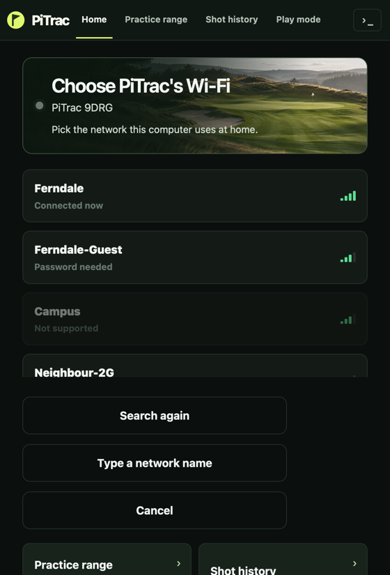

# PiTrac Easy-Connect

> **Not affiliated with PiTrac.** Easy-Connect is an independent project. It is
> not made, reviewed, endorsed, or supported by the PiTrac project or the people
> who maintain it, and it contains none of their code. The name indicates which
> hardware this software is for, nothing more. PiTrac itself can be found at
> [PiTracLM/PiTrac](https://github.com/PiTracLM/PiTrac)

**Connect your PiTrac enclosure to Wi-Fi and send shots to GSPro or E6 Connect from one desktop app.**

PiTrac Easy-Connect makes a PiTrac launch monitor easier to set up and use. It
includes a small program that runs on the Raspberry Pi inside the enclosure and
a native desktop app for macOS and Windows. The app always runs in its
own application window. It connects the enclosure to your home Wi-Fi, finds it
automatically, and sends each measured shot to GSPro or E6 Connect. It also
includes PiTrac's dashboard, shot history, and a practice range.

A five-step guide walks you through the first setup. If you move the enclosure to another home, you only need to choose the new Wi-Fi network. You do not need to reconfigure PiTrac.

- **Download:** <https://tylerpardun.github.io/pitrac-easy-connect/>
- **Version:** 0.9.0
- **License:** [MIT](LICENSE)


*Each shot follows a path based on its measured launch data, with the shot pattern for each club shown below.*

---


## What Easy-Connect Does

| Capability | Details |
|---|---|
| **Wi-Fi setup** | Scan for nearby networks and connect the enclosure from the app. Known networks appear first and reconnect automatically when the enclosure is turned on |
| **First-time connection** | Before the enclosure is connected to your home Wi-Fi, it creates a temporary network of its own. This lets you complete setup from a phone or laptop |
| **Connection recovery** | If a new Wi-Fi connection fails, the enclosure returns to the previous network within two and a half minutes. It can also recover if power is lost during the change |
| **Find and connect** | The app finds the enclosure automatically. One click links the app and enclosure, and other computers cannot connect unless the owner allows them |
| **Simulator connection** | Sends each measured shot to GSPro or E6 Connect. PiTrac is pointed at Easy-Connect once, when the enclosure is set up, and never again — so a new router, a new address, or a move to another house does not break shot delivery. A **Simulator** page shows which one is selected, whether it is answering, and the steps to get it listening |
| **Setup and system checks** | A five-step guide handles the first setup. The app also checks that the cameras, calibration, software, storage, and other essentials are ready, then explains anything that needs attention |
| **Shot history and practice range** | Every shot is saved with the club it was hit with, including shots played through GSPro or E6 Connect. The same shots build the practice range, which shows ball flight, distance, height, accuracy, and shot patterns without GSPro, E6 Connect, an account, or an internet connection. Recent shot images PiTrac has saved are shown separately |
| **Dashboard and settings** | Includes PiTrac's dashboard and tools to back up, restore, update, or reset the enclosure for a new owner |

### What it looks like

| | |
|---|---|
|  |  |
| **One line and one next step.** The app tells you whether the system is ready and, if not, what needs attention. | **Every shot stays with its club**, along with ball speed, launch, spin, and shot pattern, so you can see what each club is actually doing. |



**Wi-Fi setup from the app.** If the enclosure has never joined a network, it
creates a temporary one so you can set it up from a phone or laptop. Known
networks appear first, a padlock marks those that require a password, and signal
strength is easy to see.

If the new network does not work, the enclosure restores the previous one within
two and a half minutes. It can also recover if power is lost during the change.
This prevents a failed network change from leaving you unable to reconnect.

<br clear="right">

---

## How It Works

PiTrac sends each measured shot to Easy-Connect inside the enclosure. The desktop app receives it over your home Wi-Fi and passes it to the simulator running on the same computer.

```
PiTrac enclosure  →  Home Wi-Fi  →  Easy-Connect app  →  GSPro / E6 Connect
```

The app finds the enclosure automatically, limits access to computers you have approved, and does not require a Windows firewall rule. Changing homes or Wi-Fi networks does not change PiTrac's setup.

---

## Install on the Raspberry Pi

PiTrac itself must already be installed and working — see
[PiTracLM/PiTrac](https://github.com/PiTracLM/PiTrac). If you are starting with
a blank memory card, install PiTrac first by following
[PiTracLM's own instructions](https://github.com/PiTracLM/PiTrac).
It covers the entire process, from flashing the card to running the launch
monitor.

Once PiTrac is working, copy this repository to the Pi. From your own computer:

```bash
git clone https://github.com/TylerPardun/pitrac-easy-connect
cd pitrac-easy-connect
scp -r . <username>@<Pi name>.local:~/easy-connect
```

Then on the Pi:

```bash
cd ~/easy-connect
sudo ./packaging/pi/install.sh
```

If `pitrac.local` does not answer, use the Pi's IP address instead — your
router lists it. If you have used this Pi before and `ssh` refuses to connect
after the card was rewritten, run `ssh-keygen -R pitrac.local` and try again.

The installer checks the enclosure, installs and starts Easy-Connect, prepares
PiTrac to send shots to the app, and prints the **owner card**.

> **Photograph the owner card.** Its setup Wi-Fi password is generated for that
> Pi alone, and it is the only way to reconnect if the enclosure cannot reach
> a network.

Re-run the same installer to upgrade. Your setup, saved Wi-Fi networks,
connected computers, and camera calibration are all preserved.

The service assigns each enclosure the stable hostname printed in its identity,
`pitrac-<device id>.local`, and publishes `_pitrac._tcp` through Avahi. UDP
discovery remains the primary search path and keeps working when mDNS is
unavailable.

---

## Install the desktop app

Download the build for your computer from
<https://tylerpardun.github.io/pitrac-easy-connect/>:

| Platform | File |
|---|---|
| macOS 11+, Apple silicon (M1 or later) | [`PiTrac-Easy-Connect-macos-apple-silicon.zip`](https://github.com/TylerPardun/pitrac-easy-connect/releases/latest/download/PiTrac-Easy-Connect-macos-apple-silicon.zip) |
| macOS 11+, Intel | [`PiTrac-Easy-Connect-macos-intel.zip`](https://github.com/TylerPardun/pitrac-easy-connect/releases/latest/download/PiTrac-Easy-Connect-macos-intel.zip) |
| Windows 11 | [`PiTrac-Easy-Connect-windows-setup.exe`](https://github.com/TylerPardun/pitrac-easy-connect/releases/latest/download/PiTrac-Easy-Connect-windows-setup.exe) |

The two Mac builds are not interchangeable. Rosetta translates Intel code to
run on Apple silicon and never the other way, so an Intel Mac given the Apple
silicon build cannot start it at all. **Apple menu → About This Mac** says
which you have: a chip beginning with M, or an Intel processor.

The release workflow signs and notarizes macOS and Authenticode-signs Windows
whenever the release environment holds the required certificates; a release
that is not fully signed publishes as a GitHub pre-release rather than a
final one, with the exact reason in its notes (see
`packaging/release-signing-gate.py`). Until signed, or on any build you run
from source, those operating systems warn the first time:

| Platform | What to do |
|---|---|
| macOS | Right-click the app and choose **Open** rather than double-clicking |
| Windows | Choose **More info**, then **Run anyway** |

On Windows the installer places the application for you. On macOS, keep the
`.app` whole and put it in Applications. A loose executable copied to
Downloads, Desktop, Documents, a home directory, or another unrelated folder
is not a supported installation, and automatic replacement is deliberately
refused because that folder is not a disposable application installation.

If macOS cannot find PiTrac, open **System Settings → Privacy & Security →
Local Network** and allow PiTrac Easy-Connect, then search again.

The Raspberry Pi's temporary setup page is intentionally browser-based. A new
enclosure has not joined your network yet, so a phone or computer connects to
its temporary Wi-Fi and opens `http://10.42.0.1`. This does not apply to the
installed desktop app, which stays in its own window.

### Checking a download

Every release is signed at build time, and each one ships a `SHA256SUMS.txt`.
To confirm a file came from this repository's own build, with the
[GitHub CLI](https://cli.github.com):

```bash
gh attestation verify PiTrac-Easy-Connect-windows-setup.exe --repo TylerPardun/pitrac-easy-connect
```

That names the workflow, commit and run that produced it. To check the bytes
alone, compare them against `SHA256SUMS.txt` — `shasum -a 256 -c` on macOS, `Get-FileHash` on Windows.

This proves where a file came from. It is not the certificate that would stop
the warnings above; those need paid programmes from Microsoft and Apple.

Every release from v0.9.0 onward also publishes a `release-manifest.json` and
a detached Ed25519 signature over it, listing the exact assets, sizes and
digests the release contains. Both the desktop app and the enclosure verify
that signature against a public key built into the application before
trusting anything in it, including the digest a download is checked against —
a checksum served by the same API as the file it describes proves the bytes
arrived intact, not that this project produced them, which is what the
signature is for. A release that should carry one and does not, or whose
signature does not check out, is refused rather than installed.

Easy-Connect coordinates its two updates in one direction. If a newer release
exists, install and restart the desktop app first. Only that current desktop
may ask the enclosure to install the exact same release tag. The app reports
success only after the enclosure reconnects and both sides report that version.
The versioned `.pyz` attached to each release is this verified Pi-service
payload for the enclosure; it is not a desktop application.

Open the app and follow five steps: find the enclosure, choose your simulator,
open it, send a test shot, and play. The guide does not appear again after
the first-time setup, but you can reopen it with **Advanced → Run setup again**.

---

## Build the app from source (optional)

Building from source requires Python 3.10 or newer for the desktop dependencies.
PyInstaller bundles the interpreter for the platform on which it runs, so each
artifact must be built on its own operating system. Cross-compiling is not
supported.

```bash
git clone https://github.com/TylerPardun/pitrac-easy-connect
cd pitrac-easy-connect
./packaging/build-app.sh
```

The build is written to `dist/` as `PiTrac Easy-Connect.app` on macOS,
`PiTrac Easy-Connect.exe` on Windows. The
script installs the pinned build dependencies. To launch from source instead,
run `python3 -m pip install -e ".[desktop]"` and then `pitrac-easy-connect`.
Use `pitrac-easy-connect --headless` only for CI, API tests, or service use.

---

## Licensing

**Easy-Connect is licensed under the MIT License.** PiTrac itself is GPL-2.0 and belongs to [PiTracLM](https://github.com/PiTracLM/PiTrac).
PiTrac does the hard work, and it is not my project. Easy-Connect handles the setup and connectivity around it so the launch monitor is easier to install, move, and use.
