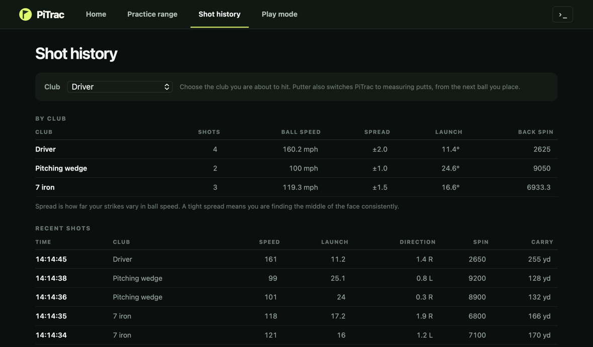

# PiTrac Easy-Connect

> **Not affiliated with PiTrac.** Easy-Connect is an independent project. It is
> not made, reviewed, endorsed, or supported by the PiTrac project or the people
> who maintain it, and it contains none of their code. The name indicates which
> hardware this software is for, nothing more. PiTrac itself can be found at
> [PiTracLM/PiTrac](https://github.com/PiTracLM/PiTrac)

**Connect your PiTrac enclosure to Wi-Fi and play on a built-in range, in OpenGolfSim, or in GSPro, from one desktop app.**

PiTrac Easy-Connect makes a PiTrac launch monitor easier to set up and use. It
includes a small program that runs on the Raspberry Pi inside the enclosure and
a native desktop app for macOS and Windows. The app always runs in its
own application window. It connects the enclosure to your home Wi-Fi, finds it
automatically, and puts each measured shot on its own range or into GSPro. It also
includes PiTrac's dashboard, shot history, and a practice range.

A short guide walks you through the first setup. If you move the enclosure to another home, you only need to choose the new Wi-Fi network. You do not need to reconfigure PiTrac.

- **Version:** 0.10.6
- **License:** [MIT](LICENSE)


*Each shot follows a path based on its measured launch data, with the shot pattern for each club shown below.*

---


## What Easy-Connect Does

| Capability | Details |
|---|---|
| **Wi-Fi setup** | Scan for nearby networks and connect the enclosure from the app. Known networks appear first and reconnect automatically when the enclosure is turned on |
| **First-time connection** | Before the enclosure is connected to your home Wi-Fi, it creates a temporary network of its own. This lets you complete setup from a phone or laptop |
| **Connection recovery** | If a new Wi-Fi connection fails, the enclosure returns to the previous network within two and a half minutes. It can also recover if power is lost during the change |
| **Find and connect** | The app finds the enclosure automatically. One click links the app and enclosure, and other computers cannot connect unless the owner allows them |
| **Local Range** | A first-person range with nothing else to buy, open or sign in to. Set a target, and the club is chosen from its distance and how far you hit each one; change it with one key. Every shot shows carry, total, distance to the pin, speed, launch, direction and spin, and the session shows where they finished. Works on macOS and Windows |
| **OpenGolfSim** | Plays its range and courses on macOS and Windows. It is free and separate: choose **Developer API** as its launch monitor. Each shot shows whether it was played, and where the simulator says it went |
| **GSPro** | Sends each measured shot to GSPro, which runs on Windows. PiTrac is pointed at Easy-Connect once, when the enclosure is set up, and never again — so a new router, a new address, or a move to another house does not break shot delivery. A **Play mode** page shows which is selected, whether GSPro is answering, and the steps to get it listening |
| **Setup and system checks** | A short guide handles the first setup. The app also checks that the cameras, calibration, software, storage, and other essentials are ready, then explains anything that needs attention |
| **Shot history and practice range** | Every shot is saved with the club it was hit with, including shots played through GSPro. Averages build up with or without a simulator. Recent shot images PiTrac has saved are shown separately |
| **Updates** | The app checks for new versions itself and offers **Update now** on its first page. After it restarts it brings the enclosure to the same version by itself, and the enclosure puts the previous version back if a new one does not start |
| **Dashboard and settings** | Includes PiTrac's dashboard and tools to back up, restore, or reset the enclosure for a new owner |

### What it looks like

| | |
|---|---|
|  |  |
| **One line and one next step.** The app tells you whether the system is ready and, if not, what needs attention. | **Every shot stays with its club**, along with ball speed, launch, spin, and shot pattern, so you can see what each club is actually doing. |


**Wi-Fi setup from the app.** If the enclosure has never joined a network, it
creates a temporary one so you can set it up from a phone or laptop. Known
networks appear first, a padlock marks those that require a password, and signal
strength is easy to see.

If the new network does not work, the enclosure restores the previous one within
two and a half minutes. It can also recover if power is lost during the change.
This prevents a failed network change from leaving you unable to reconnect.

<br clear="right">

---

## How It Works

PiTrac sends each measured shot to Easy-Connect inside the enclosure. The desktop app receives it over your home Wi-Fi and draws it on the range, or passes it to a simulator on the same computer.

```
PiTrac enclosure  →  Home Wi-Fi  →  Easy-Connect app  →  Local Range, OpenGolfSim or GSPro
```

The app finds the enclosure automatically, limits access to computers you have approved, and does not require a Windows firewall rule. Changing homes or Wi-Fi networks does not change PiTrac's setup.

---

## Set up a Raspberry Pi from scratch

This takes a blank memory card to a working enclosure. Steps 1 to 3 are the
Raspberry Pi and PiTrac itself; step 4 is Easy-Connect. If PiTrac is already
installed and measuring, go straight to step 4.

**You will need:** a Raspberry Pi 5 (this release is tested on one), a 32 GB or
larger microSD card, a computer to write the card from, and the PiTrac hardware:
two global-shutter cameras (Raspberry Pi Global Shutter or InnoMaker IMX296),
two **Raspberry Pi 5 camera cables** (narrow 22-pin end for the Pi, wide 15-pin
end for the camera) and the rest of PiTrac's build. PiTrac's
[build guide](https://docs.pitrac.org/build-guide/) covers the hardware.

### 1. Write the memory card

1. Install [Raspberry Pi Imager](https://www.raspberrypi.com/software/) and
   choose **Raspberry Pi 5**, then **Raspberry Pi OS (64-bit)**. This release is
   tested on the Debian 13 "trixie" release of it.
2. When Imager offers to customise the settings, set:
   - a **username and password** (PiTrac installs for this user),
   - your **Wi-Fi** network and **country** (Easy-Connect takes over the Wi-Fi
     later, but this gets the Pi online for the install),
   - **SSH**, with password authentication.
3. Write the card, put it in the Pi and switch on. After a minute or two, from
   your computer:

   ```bash
   ssh <username>@<hostname>.local
   ```

   If the name does not answer, use the Pi's IP address from your router's
   list of devices.

### 2. Connect the cameras and check them

Always **switch the Pi off** before plugging or unplugging a camera cable: it
only looks for cameras when it starts.

1. Plug the narrow end of each cable into the Pi's **CAM/DISP 0** and
   **CAM/DISP 1** connectors, and the wide end into each camera. At every end,
   lift the latch, push the cable fully in and close the latch, with no bare
   contacts showing.
2. Switch on and run:

   ```bash
   rpicam-hello --list-cameras
   ```

   Both cameras should be listed. If it says **No cameras available!**, a likely
   cause is a cable fitted upside down at one end, which stops the camera
   answering at all (`dmesg | grep imx296` then shows `failed ... -121`).
   Switch off, turn the cable over **at the camera end**, and try again; if
   that does not help, swap cables and cameras to see which one follows.

### 3. Install PiTrac

Easy-Connect is tested against one PiTrac revision, and PiTrac has no numbered
releases, so check that revision out before building:

```bash
sudo apt update && sudo apt install -y git
git clone https://github.com/PiTracLM/PiTrac.git
cd PiTrac
git checkout 78f1de60fd21398f34d348f19f55e73029bc95f9
cd packaging
sudo ./build.sh dev
```

This builds and installs PiTrac, its camera tools and its dashboard, and takes a
while. Then follow PiTrac's build guide to **calibrate the strobe and the
cameras**; PiTrac will not take pictures until the strobe is calibrated. Its
dashboard is at `http://<hostname>.local:8080`.

A newer PiTrac may work: Easy-Connect checks what PiTrac answers and says
plainly when it cannot use it. Avoid PiTrac's own update button, which can move
it past the tested revision.

### 4. Install Easy-Connect

On the Pi:

```bash
cd ~
curl -L -o easy-connect.tar.gz https://github.com/TylerPardun/pitrac-easy-connect/archive/refs/tags/v0.10.6.tar.gz
tar -xzf easy-connect.tar.gz
cd pitrac-easy-connect-0.10.6
sudo bash packaging/pi/install.sh
```

With a kit on a USB stick instead, copy its source zip to the Pi and run
`unzip "PiTrac Easy-Connect"*source.zip`, `cd PiTrac-Easy-Connect` and the same
`sudo bash packaging/pi/install.sh`.

The installer checks the Pi, installs and starts Easy-Connect, prepares PiTrac
to send shots to it, and prints the **owner card**:

> **Photograph the owner card.** Its setup Wi-Fi password is generated for that
> Pi alone. It is the only way back in if the enclosure cannot reach a network,
> and it is how a second computer is given access.

The enclosure takes the stable name printed on the card,
`pitrac-<device id>.local`. If it cannot join a saved network it makes its own,
named on the card, so it can always be set up. That is all that is ever done on
the Pi: from now on **the app updates it**, and nothing needs installing there
again. (An enclosure set up before 0.10.6 needs this step run once more to
receive updates from the app; the app says so when it meets one.)

If `ssh` refuses to connect after a card was rewritten, run
`ssh-keygen -R <hostname>.local` and try again.

### When something is not right

| What you see | What to do |
|---|---|
| **No cameras available!** or *0 of 2 cameras detected* | Switch off, turn the cable over at the camera end, switch on. The app's camera check names the cause it finds |
| *PiTrac does not offer /api/sims* | PiTrac is older than the tested revision; repeat step 3 |
| PiTrac's camera test says the strobe needs calibrating | Calibrate the strobe in PiTrac's dashboard first |
| The app says **PiTrac needs a one-time reinstall** | Run step 4 again; settings and pairings are kept |
| The app cannot find the enclosure | Check it has power; give it two minutes; on a new network it makes its own Wi-Fi, named on the owner card |

---

## Install the desktop app

Everything comes in one folder, the **kit**, made for a USB stick and for places
with no internet: the Mac and Windows installers, what the Raspberry Pi needs, a
blank owner card, and a short `READ ME FIRST.txt`.

| Computer | File |
|---|---|
| Mac | `PiTrac Easy-Connect <version> (Mac ...).dmg`. Drag the app into Applications |
| Windows 11 | `PiTrac Easy-Connect <version> (Windows).exe` |

Download them from the [latest release](https://github.com/TylerPardun/pitrac-easy-connect/releases/latest)
(the Mac `.zip` for Apple silicon or Intel, or the Windows `-setup.exe`), or
take them from a kit.

Neither is signed with a paid certificate, so each system asks the first time:

| Computer | What to do |
|---|---|
| Mac | Open it once, then **System Settings → Privacy & Security → Open Anyway** |
| Windows | **More info**, then **Run anyway** |

**Updates.** When a new version is out, the app says so at the top of its first
page. Press **Update now**: it installs, restarts, and then brings the enclosure
to the same version by itself. Pairing, Wi-Fi, calibration, settings, and shot
history are kept. Copies of Easy-Connect before 0.10.6 cannot update
themselves; install 0.10.6 by hand once.

**More than one computer.** The first computer to connect is trusted
automatically. Any other computer asks for the password on the owner card, or
can be let in from a computer that is already trusted (**Pair another
computer**). The enclosure talks to one computer at a time and remembers the
others; **Connect here** moves it to the one in front of you.

If macOS cannot find PiTrac, open **System Settings → Privacy & Security →
Local Network** and allow PiTrac Easy-Connect, then search again.

Wi-Fi is set up in the app too. A new enclosure, or one somewhere new, makes a
Wi-Fi network of its own. Join it from your computer's Wi-Fi menu with the
password on the owner card, and the app asks which network to use. A phone can do
the same at `http://10.42.0.1` if there is no computer to hand.

Open the app, find the enclosure, choose how to play, and play. A simulator adds
two steps: opening it, and one shot to make sure. The guide does not appear again after
the first-time setup, but you can reopen it with **Home → Device settings → Run setup again**.

Home shows connection status and offers the next action. Use **Practice range** to play,
**Shot history** to review a session, and **Play mode** to choose a simulator. The
**›_** button in the upper right opens the developer console. **Alt+Shift+D** (Option+Shift+D
on Mac) also opens it. Connection details, recent errors, camera checks and raw shots are there.

---

## Build the installers

Each is built on the kind of computer it is for, because it bundles that
computer's Python. Nothing is uploaded, and no GitHub minutes are used.

**On a Mac**, with Python 3.10 to 3.13:

```bash
python3 packaging/make_installer.py
```

Python from [python.org](https://www.python.org/downloads/macos/) makes an app
that runs on older versions of macOS too. Homebrew's makes one only for the
version it was built on. The build says which it made.

**On Windows**, unpack the source and double-click **Build Windows Installer**. It
asks before installing Python or Inno Setup.

Either one installs what it built, opens it, uses it, and removes it again before
putting it in `dist/`. To run the app from source instead:

```bash
python3 -m pip install -e ".[desktop]" && pitrac-easy-connect
```

---

## Licensing

**Easy-Connect is licensed under the MIT License.** PiTrac itself is GPL-2.0 and belongs to [PiTracLM](https://github.com/PiTracLM/PiTrac).
PiTrac does the hard work, and it is not my project. Easy-Connect handles the setup and connectivity around it so the launch monitor is easier to install, move, and use.
